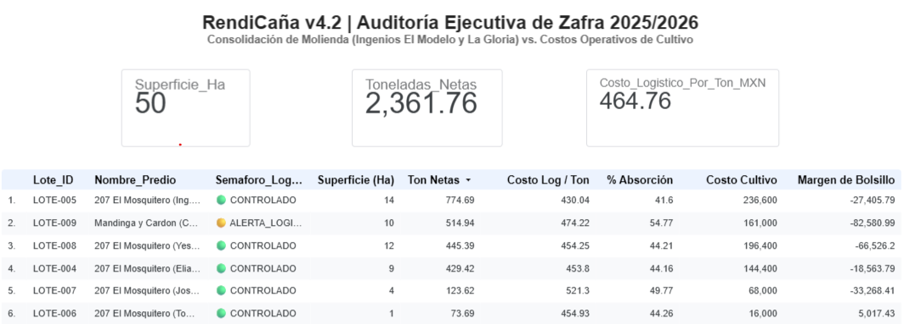

# RendiCaña v4.2: Arquitectura Cloud-Native de Inteligencia Financiera y Auditoría de Zafra ($0 USD)

> **Titular:** Elías Cruz Álvarez  
> **Rol:** Analytics Translator & Senior SaaS Architect  
> **Especialidad:** Optimización Agroindustrial, Modelado Dimensional y Gobernanza de Datos  
> **Stack:** Google Cloud Platform (BigQuery Sandbox) | Looker Studio | Git / GitHub  

---

## 1. El Problema de Negocio (Wicked Environment)
En la cuenca cañera de Veracruz (zona de abastecimiento de factorías como *Ingenio El Modelo* e *Ingenio La Gloria*), los productores tradicionales enfrentan una **ceguera financiera estructural**:
* **Desconocimiento del Margen Real de Bolsillo:** El productor recibe la liquidación final del ingenio y asume que el alcance depositado representa su utilidad, sin auditar ni conciliar los egresos de efectivo acumulados durante los 12 meses de cultivo (fertilización, combustible, labores mecánicas y jornales).
* **Opacidad en Deducciones de Báscula:** Los descuentos por corte mecanizado, flete de acarreo, cuotas IMSS y castigos por materia extraña absorben más del 50% del valor bruto liquidable, sin un control granular por predio.

---

## 2. Arquitectura de Datos (Framework E.V.A.)

Operando bajo la **regla estricta de $0 USD de costo de infraestructura**, el sistema se diseñó desacoplando el almacenamiento de la capa lógica y de visualización:

```text
┌──────────────────────────────────────┐
│  Captura Normalizada de Zafra (v4.2) │
└──────────────────┬───────────────────┘
                   │
                   ▼
┌────────────────────────────────────────────────────────────────────────┐
│             Google BigQuery Sandbox (Almacén Dimensional)             │
│  • dim_parcelas: Catastro, tenencia y régimen fiscal SAT (Multi-tenant)│
│  • fact_karbe_molienda: Liquidaciones de báscula, KARBE y retenciones   │
│  • fact_registro_costos: Transacciones de campo (Partición diaria)     │
└──────────────────┬─────────────────────────────────────────────────────┘
                   │
                   ▼ (Vía CTEs deterministas sin mutación física)
┌────────────────────────────────────────────────────────────────────────┐
│              vw_datos_maestros (Capa Semántica y Lógica)               │
│  • Pre-agregación de costos (eliminación de producto cartesiano / fan) │
│  • Cálculo de Margen Neto de Bolsillo y Semáforo de Riesgo Logístico   │
└──────────────────┬─────────────────────────────────────────────────────┘
                   │
                   ▼ (DirectQuery a $0 USD de cómputo)
┌────────────────────────────────────────────────────────────────────────┐
│                   Looker Studio (Dashboard Ejecutivo)                  │
│  • KPIs de Superficie, Molienda y Costo Unitario de Acarreo            │
│  • Matriz de Rentabilidad Predial y Auditoría de Deducciones           │
└────────────────────────────────────────────────────────────────────────┘

```

### Modelo Dimensional Estrella

* **`dim_parcelas`:** Dimensión conformada que registra superficie real cosechada, variedad agronómica, contrato de ingenio y régimen fiscal SAT (RESICO, PFAE, AGAPE).
* **`fact_karbe_molienda`:** Hechos transaccionales de báscula en batey (toneladas brutas/netas, castigo de materia extraña, KARBE certificado y retenciones de zafra).
* **`fact_registro_costos`:** Hechos operacionales de insumos y mano de obra con partición por `Fecha` y clustering por `(Productor_ID, Lote_ID)`, controlando trazabilidad de CFDI.
* **`vw_datos_maestros`:** Vista federada compilada con CTEs que precalcula los costos agregados por lote antes del `LEFT JOIN`, erradicando duplicidades (*fan-out effect*) y computando el semáforo en tiempo real.

---

## 3. Hallazgos Financieros y Retorno de Inversión (ROI)

Auditando un ciclo agrícola real de **50.0 Hectáreas** y **2,361.76 Toneladas Netas** distribuidas en 6 predios piloto:

| Indicador Financiero Clave | Valor Auditado (MXN) | Interpretación de Negocio |
| :--- | :---: | :--- |
| **Valor Bruto Devengado en Zafra** | **$2,350,922.23** | Liquidación total calculada por tonelaje neto y KARBE. |
| **Deducciones Totales de Zafra** | **$1,408,745.93** | Retenciones del ingenio por corte, flete, cuotas y amortizaciones. |
| **Tasa de Absorción Logística Promedio** | **59.92%** | Cosecha y acarreo consumen más de la mitad del valor del cañal. |
| **Alcance Neto Depositado por Ingenio** | **$599,072.25** | Efectivo aparente recibido por los productores en banco. |
| **Inversión Agronómica de Campo** | **$822,400.00** | Egresos reales de cultivo ($16,000–$17,000 MXN/Ha en soca). |
| **Margen Neto de Bolsillo Real** | **-$223,327.75** | **Déficit operativo consolidado encubierto para el cañero.** |

```text
                       DESGLOSE DE FLUJO FINANCIERO
  Ingreso Bruto de Zafra: $2,350,922.23 MXN
  │
  ├── [ - ] Deducciones de Factoría: $1,408,745.93 MXN (59.92% Absorción)
  │         └── Alcance Líquido de Báscula: $599,072.25 MXN
  │
  └── [ - ] Egresos Reales de Cultivo: $822,400.00 MXN (Fertilizantes + Labores)
            └── SALDO FINAL DE BOLSILLO: -$223,327.75 MXN (Déficit Real)
```

### Diagnóstico de Semáforo de Riesgo

* **SOBRECOSTO LOGISTICO (Mayor al 55% de absorción):** Predios donde el flete y corte castigaron severamente la utilidad.
* **CONTROLADO (Menor al 50% de absorción):** Predios optimizados donde el margen neto amortizó los costos de cultivo (ej. `LOTE-006` con utilidad positiva de **+$5,017.43 MXN**).

---

## 4. Evidencia Visual del Dashboard (Looker Studio)



---

## 5. Estructura del Repositorio

* **`sql/`**: Scripts DDL de tablas particionadas, ingesta atómica y vista maestra compilada.
  * `01_dim_parcelas.sql`: Catastro parcelario y régimen fiscal SAT.
  * `02_fact_karbe_molienda.sql`: Liquidaciones y retenciones del ingenio.
  * `03_fact_registro_costos.sql`: Inversión agronómica particionada por fecha.
  * `04_vw_datos_maestros.sql`: Motor lógico de márgenes y semáforos.
  * `05_auditoria_metricas.sql`: Script de cuadratura y validación de totales.
* **`docs/`**: Diccionario de datos oficial v4.2 con reglas de negocio y calibración de costos estándar de soca ($16,810/Ha) y plantilla ($34,690/Ha).
* **`img/`**: Capturas del reporte ejecutivo interactivo desplegado en Looker Studio.
